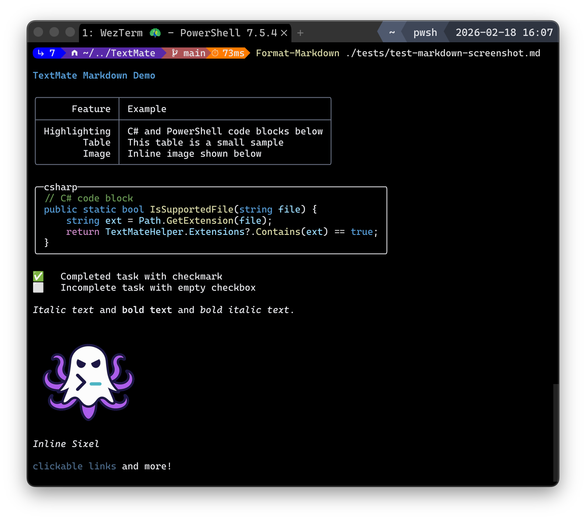

# TextMate

TextMate highlights source code in PowerShell using Tint and its managed GregsEx engine. The default output is a source-preserving `HighlightedDocument` displayed directly as ANSI or plain text. No other PowerShell module or rendering framework is required. Optional renderers return native Spectre or XenoAtom objects for application layouts.

What it does

- Highlights source text using TextMate grammars such as PowerShell, C#, Markdown, Python, YAML, TOML, and KDL v1.
- Builtin pager, either through `-Page` or piping to `Out-Page`
- Returns structured text and styled ranges by default, without allocating a string or object for each token.
- Offers `-OutputFormat Text`, `Spectre`, `Fullscreen`, or `Html`. Optional renderers load on first explicit use.
- Provides discovery and testing helpers for installed grammars, extensions, or language IDs.
- The same rich Markdown, tables, hyperlinks, wrapping and line numbers in every output format. `-OutputFormat` selects the returned type; `-Alternate` selects Markdown source highlighting for all formats.
- Optional image decoding provides the same true-color cell preview in every format; missing images or a missing decoder produce the same linked image label.



## Cmdlets

| Cmdlet | Purpose |
|--------|---------|
| [Format-TextMate](docs/en-us/Format-TextMate.md) | Render text with an inferred or explicit language. |
| [Format-CSharp](docs/en-us/Format-CSharp.md) | Highlight C# source |
| [Format-Markdown](docs/en-us/Format-Markdown.md) | Highlight Markdown content |
| [Format-PowerShell](docs/en-us/Format-PowerShell.md) | Highlight PowerShell code |
| [Get-TextMateGrammar](docs/en-us/Get-TextMateGrammar.md) | List available grammars and file extensions. |
| [Add-TextMateLanguage](docs/en-us/Add-TextMateLanguage.md) | Register a local grammar, aliases and extensions. |
| [Add-TextMateTheme](docs/en-us/Add-TextMateTheme.md) | Register a local theme by name. |
| [Test-TextMate](docs/en-us/Test-TextMate.md) | Check support for a file, extension, or language ID. |
| [Out-Page](docs/en-us/Out-Page.md) | Builtin terminal pager |

```note
Format-CSharp/Markdown/Powershell is just syntactic sugar for Format-TextMate -Language CSharp/PowerShell/Markdown
```

## Examples

```powershell
# highlight a C# snippet
"public class C { void M() {} }" | Format-CSharp

# render a Markdown file with a theme
Get-Content README.md -Raw | Format-Markdown -Theme SolarizedLight

# Choose a native type while retaining the same Markdown presentation
Get-Content README.md -Raw | Format-Markdown -OutputFormat Spectre -Width 80

# FileInfo Object
Get-Item .\script.ps1 | Format-TextMate

# list supported grammars
Get-TextMateGrammar
```

## Installation

```powershell
Install-Module TextMate
```

### Prerequisites

- **PowerShell**: 7.6 or later (.NET 10)

### Building from Source

1. Clone this repository
2. Open a terminal in the project directory
3. Build the project:

```powershell
pwsh.exe -NoProfile -File .\build.ps1
```

1. Import the module:

```powershell
Import-Module .\output\TextMate.psd1
```

The default build contains the managed highlighting engine, built-in renderer, and lightweight adapters for native output. It does not bundle UI frameworks. Requesting `-OutputFormat Spectre` imports an installed `PwshSpectreConsole`; `-OutputFormat Fullscreen` imports an installed `fullscreen` module. Text output loads neither. To bundle optional UI runtimes when building a package:

```powershell
pwsh.exe -NoProfile -Command { & .\build.ps1 -Renderer Spectre, XenoAtom }
```

Markdown images use the optional [Sixel module](https://github.com/trackd/Sixel), imported into the caller's runspace only when an image is encountered. TextMate never installs it automatically. Its `ConvertTo-Sixel -Protocol Blocks -Force` output becomes shared styled cells, so Text, Spectre and XenoAtom show identical images without terminal probing. Missing modules or conversion failures retain the image's clickable label. TextMate ships no image codecs and requires no Six Labors license. Ordinary highlighting does not load the image bridge or Sixel.

Mermaid fences currently display their source as code. Diagram rendering is deferred until the separate Mermaid library is integrated.

The pager uses Sixel when the optional Sixel module reports support. Markdown images retain the module-generated pixel payload in `Images`, alongside the shared cell presentation; `GetImageBounds(index)` resolves their footprint. Image requests fit the available columns and content rows, accounting for terminal cell dimensions and the pager footer/search area. PNG, JPEG, GIF, BMP, WebP, TIFF/BigTIFF, TGA, QOI, Netpbm (PBM/PGM/PPM), ICO/CUR, ANI and OpenEXR dimensions are read from bounded headers without decoding pixels. The converted image's cell dimensions come from Sixel's output object. Images scroll as whole units, without switching to blocks when partly visible. Their space remains blank until the complete image fits inside the content viewport. Unsupported terminals use the portable cell presentation. Compatibility queries from older Sixel releases run with temporary console-mode ownership and restore the entry modes afterwards.

Multiple rich documents piped to `Out-Page` retain their Sixel payloads in disk-backed history. Image rows stay together when the terminal narrows. The pager caches at most one decoded image up to 4 MiB, separately from its bounded text cache, and deletes its history files on exit. Ordinary streamed text does not probe for graphics or import Sixel. The built-in terminal formatter can emit retained pixels directly; `.ToAnsi()` keeps the portable cell representation unless graphics output is explicitly requested through `TextRenderer.Write(..., graphics: true)`.

You can import the consuming application explicitly before requesting native output. The adapter uses that application's framework assembly and load context:

```powershell
Import-Module PwshSpectreConsole
Import-Module TextMate
$renderable = 'Write-Output 42' | Format-PowerShell -OutputFormat Spectre
$renderable | Format-SpectrePanel -Header 'PowerShell'

Import-Module fullscreen
$visual = 'Write-Output 42' | Format-PowerShell -OutputFormat Fullscreen
# $visual is a native XenoAtom Visual backed by styled Paragraph content.
```

Text output remains an object with conversion methods. HTML uses the same displayed content, colors, links and line numbers in an escaped `<pre>` fragment; it requires no rendering framework:

```powershell
$document = 'Write-Output "hello"' | Format-PowerShell
$renderable = $document.ToSpectre()
$visual = $document.ToFullscreen()
$fragment = $document.ToHtml()
$document.ToHtml($true) | Set-Content -LiteralPath ./example.html -Encoding utf8
# Or: Format-Markdown ./README.md -OutputFormat Html
```

For direct terminal writing, use `.WriteTo([Console]::Out)` instead of `.ToAnsi()`. It writes buffered spans without materializing an ANSI string. Retained documents still own their text/ranges; explicit string conversion and PowerShell's formatter allocate their returned strings so `Out-String` and redirection keep working.

For lexical source output that does not need a retained document, rich Markdown or reflow, stream straight from the highlighter:

```powershell
[PSTextMate.Core.SyntaxHighlighter]::WriteTo('Write-Output 42', [Console]::Out)
```

The streaming method accepts `ReadOnlySpan<char>` in C# as well as strings, preserves source whitespace and multiline syntax state, and displays unsafe source controls literally. It avoids document/range-array allocations; the syntax engine can still allocate. `TextBufferWriter` exposes reusable owned storage as a borrowed `WrittenSpan` for custom render loops. Do not retain that span across writes, clearing or disposal. Immutable `TextContent` caches its most recent layout width, so repeated `.WriteTo(writer, width)` calls reuse it.

Compose output with the same dependency-free primitives used by the pager. `TextColor` is an immutable RGB/default value; `TextStyle` supplies colors, decorations and links. `TextContent` composes text or existing documents into panels, rows, columns, padding, alignment, rules, progress bars and numbered content:

```powershell
using namespace PSTextMate.Core

$style = [TextStyle]::Plain.WithForeground([TextColor]::Parse('#66D9EF'))
$content = [TextContent]::Rows(
    [TextContent]::Text('Build complete', $style),
    [TextContent]::Progress(3, 4)
).Panel('Build', '3/4')
$content                         # formats at the current PowerShell host width
$content | Out-Page
$document = $content.ToDocument(60)
$fragment = $document.ToHtml()
# Optional native objects for their respective application layouts:
# $renderable = $content.ToSpectre()
# $visual = $content.ToFullscreen()

# Existing highlighted documents compose without ANSI round-tripping:
('Write-Output 42' | Format-PowerShell).AsContent().Panel('PowerShell').ToDocument(60)
```

`PanelOptions` controls header/footer, rounded/square/double-line borders, title alignment/styles and padding. `TextContent.Columns(gap, columns)` accepts `TextColumn` values: a positive width reserves cells, and zero shares the remainder. Layout measures terminal cells and preserves grapheme boundaries, styles, links and diagram anchors. Composed documents retain their structure when a native container or pager resizes. `PanelFrame`, `LineNumberGutter`, `TextGeometry` and `TextOutput` also expose streaming helpers, so custom render loops can use the same geometry without constructing a content tree per frame.

Custom C# content can implement `ITextRenderable.Layout(int width)` and enter the composition through `TextContent.FromRenderable(value)`. The shared presentation can then be converted to Spectre, Fullscreen or HTML. `TextMateView` and `TextContent` implement the same contract. `VT` owns escape encoding and captured-output parsing; `VT.Parse(text)` turns captured ANSI into styled content, while `TextBufferWriter.WriteStyle(style)` and `.MoveTo(column, row)` write directly into reusable storage.

Run [the composition example](examples/Show-TextMateComposition.ps1) after building to see numbered code beside a status/progress panel, or select `-OutputFormat Html` to export the same layout.

The default catalog uses Tint's bundled grammars and themes. Add local files at any time with `Add-TextMateLanguage` and `Add-TextMateTheme`. Use `-Force` to replace a registration. Catalogs are held in memory for the loaded module instance; existing documents retain their original catalog and theme. Add registrations to your profile to load them in future processes. No supplemental TextMateSharp assets are shipped.

```powershell
Add-TextMateLanguage -Path ./custom.tmLanguage.json -Name custom -Extension .custom
Add-TextMateTheme -Path ./custom-theme.json -Name CustomDark
Format-TextMate ./example.custom -Theme CustomDark
```

Content roles such as headings, links and code blocks resolve through a single core scope/theme mapping. Syntax tokens retain their full engine-resolved styles. Spectre and XenoAtom adapters translate that presentation into native objects and reflow through the shared layout when their container width changes. Neither adapter parses Markdown, matches TextMate scopes or runs a pager.

The built-in pager supports editable `/` or Ctrl+F search, highlighted occurrences, n/N navigation, c to clear, ? for help, arrows/j/k, page and half-page navigation, and Home/End. It polls for resizing while idle, caches visible rows and emits only changed rows. Its terminal session is restored on quit, cancellation and errors. Use [Out-Page](docs/en-us/Out-Page.md) or any formatter's `-Page` switch.

`Out-Page` streams ordinary pipeline records into temporary disk-backed history while the producer continues. Its decoded cache retains up to 64 source lines within an approximately 4 MiB budget, supports width changes and search over earlier rows, and deletes history on exit. Press F to follow new rows; normal navigation leaves follow mode. A single rich document uses the document pager, retaining its graphics. Quitting stops upstream at its next pipeline write; Ctrl+C requests PowerShell cancellation.

Fullscreen output is a native XenoAtom Visual intended for the application's layout and event loop. Cmdlets use the current console window width when `-Width` is omitted, reading it again for each document so resizing takes effect. Hosts without a window width fall back to their buffer width or 80 columns. Set `-Width` explicitly for a narrower application viewport. The direct .NET `RendererOptions` default remains 80 because it has no PowerShell host. All adapters use the same core layout, including when a native container requests a narrower width, so it has the same text, styles and links at matching width, theme and options. `-Page` uses the same presentation for every format. Fullscreen integrations that previously relied on the default Spectre result must now explicitly request `-OutputFormat Spectre`, or request XenoAtom output and host the returned visual directly.

Source control characters such as ESC, BEL and backspace are displayed as visible glyphs rather than executed by the terminal. `Source` retains the original input. Generated styling and hyperlinks remain ANSI; Sixel and pager controls are emitted only by their explicit rendering paths.

`HighlightedDocument.Source` retains the original input, including line terminators and whitespace. `.Text` contains the displayed presentation; `.Lines` and `.Ranges` use UTF-16 offsets into `.Text`. Presentation normalizes line terminators, expands tabs to four spaces and applies common wrapping. `.WriteTo(writer, ansi)` streams output, `.ToAnsi()` creates a terminal string, and `.ToString()` returns the original source. Theme names are strings with completion for built-in and runtime-registered themes; grammar discovery returns `PSTextMate.Core.Language` with a canonical language ID. Files ending in a newline include their final empty line.

## Contributing

Build tools require PowerShell 7.6 or newer and the .NET 10 SDK. Prepare the pinned build tools, then run the same validation as CI:

```powershell
pwsh.exe -NoProfile -File ./.github/Initialize-Build.ps1
pwsh.exe -NoProfile -File ./build.ps1 -Task BuildAndTest
# Include both optional native renderers:
pwsh.exe -NoProfile -Command { ./build.ps1 -Task BuildAndTest -Renderer Spectre,Fullscreen }
```

CI validates built-in output and optional adapters on Windows, Linux and macOS. It does not require Sixel, PwshSpectreConsole or Fullscreen to be installed. PowerShell and .NET test reports are written to `TestResults` in CI, alongside the module artifact in `output`.

1. Fork the repository
2. Create a feature branch
3. Add tests for new functionality
4. Update documentation as needed
5. Submit a pull request

## Dependencies

- Bundled managed engine: [Tint](https://github.com/sebastienros/tint), [GregsEx](https://github.com/sebastienros/gregsex), grammars and themes.
- Shared Markdown presentation: Markdig, loaded only for Markdown rendering.
- Optional image support: the separately installed Sixel PowerShell module, loaded only when images are used. Direct .NET callers without a PowerShell runspace retain image links.
- Optional Spectre renderer: Spectre.Console. Markdown layout is supplied by the shared presentation layer.
- Optional XenoAtom renderer: XenoAtom.Terminal.UI and its managed dependencies.

---

[About TextMate](https://en.wikipedia.org/wiki/TextMate)
